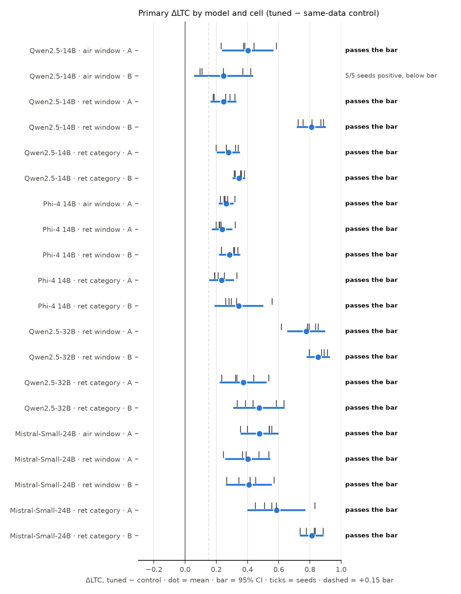

# Stale Weights

**Question.** A support team fine-tunes a model on its historical decisions, made under an old policy, and later
changes the policy only in the prompt. If the new prompt simply leaves an old rule out, does the model still apply it?

**Answer (results: [FINDINGS.md](FINDINGS.md); final report
[`reports/final/stale_weights_final_report.pdf`](reports/final/stale_weights_final_report.pdf)).**
Yes, when the fine-tuning data never showed the policy text. With a rule omitted and "apply only the rules written in
this policy" in the prompt, the adapter tuned without the policy text leans on the old rule more than a same-data
adapter trained with the policy text in its prompts. That direction held in every seed of every model and domain
tested (140/140 seed-cells). How much it changes the actual answer depends on the model, the domain, the decoding
temperature and the style of the training logs. Stating the removal explicitly reduces it; a change notice does not
reliably help.

Design v2 (2026-09-29/30): class-balanced LoRA fine-tunes (rank 8, last third of the layers, 200 steps), PEFT
training and vLLM evaluation on Modal H100s, preregistered (RESEARCH_AGENDA addenda 7–7f) after two red-team reviews
(`reviews/`). Two fictional domains (airline cancellation windows; retail return windows and final-sale categories),
four open models. Primary metric ΔLTC: how much more the tuned model's sampled P(deny) jumps across the old threshold
than the control's (0 = no use of the old rule, 1 = exact use).

| model | seeds | preregistered verdict, 5 seeds | before addendum 7f | direction (seed-cells positive) |
|---|---|---|---|---|
| Qwen2.5-14B | 5 | replicates in 5/6 cells (e.g. airline 12 h: +0.40, Holm p = .002); airline 48 h misses the CI bar | 5/6 (returns at 3 seeds) | 30/30 |
| Phi-4 14B | 5 | 5/5 (+0.23 to +0.34) | 1/5 at 2 seeds | 25/25 |
| Mistral-Small-24B | 5 | 5/5 (+0.40 to +0.81; airline 12 h +0.48) | 1/5 at 2 seeds | 25/25 |
| Qwen2.5-32B | 5 | 4/4 (returns windows +0.78 / +0.85); airline excluded, its base gate failed | 3/4 at 2 seeds | 20/20 |
| Qwen2.5-14B, log skew × reply style | 2 | descriptive; fixed-template logs leak in greedy answers at every deny share | – | 40/40 |

The extra seeds (Qwen-14B returns seeds 3–4; seeds 2–4 for the other families) were added after the 2- and
3-seed results had been seen, under addendum 7f, which applied them to every headline cell whatever its verdict and
adds no more. No cell that passed before fails now; several pass narrowly. Both sets of verdicts are in FINDINGS §3,
§4, §8–§10.

What did not hold up is listed in FINDINGS §10 ("what died"): the pilot's greedy airline result as a general claim,
"applies the exact old number" everywhere, the change notice as a fix, and the rule-structure explanation.




## Reproduce (CPU, seconds; the raw records are committed in `results/`)

```sh
uv sync && uv run pytest -q
uv run python -m staleweights.v2.analysis qwen14b     # also: phi4 qwen32b mistral24b -> results/<model>/tables.md
uv run python -m staleweights.v2.arms skew            # log skew x reply style
uv run python -m staleweights.v2.arms tsweep          # decoding temperature
uv run python reports/final_report.py                 # the final report (HTML; the PDF needs Google Chrome)
```

Rerunning training and evaluation on Modal (`uv sync --group cloud`): [`src/staleweights/cloud/README.md`](src/staleweights/cloud/README.md)
(the whole v2 study, including the seed extension, cost about $61 of metered Modal time). How to pick the project
up: [HANDOFF.md](HANDOFF.md) ("Current state"). Notebook: [AUTONOMOUS_LOG.md](AUTONOMOUS_LOG.md). Related work:
[RELATED.md](RELATED.md).

| path | what |
|---|---|
| `src/staleweights/v2/` | design v2: data, items, test suites, analysis, arms, ablation |
| `src/staleweights/cloud/` | Modal app: PEFT training mirroring mlx-lm, vLLM evaluation |
| `results/<model>/<domain>/` | raw records (`<adapter>-200.jsonl`); per model `tables.md`, `summary.json` |
| `results/qwen14b/skew/`, `tsweep/` | the log-skew × reply-style arm and the temperature sweep |
| `logs/` | console logs of each cloud stage |
| `reports/` | the final report's generator; the report and its figures are in `reports/final/` |
| `reviews/` | the two red-team reviews the v2 design answers |

## Not in the repository

- The LoRA adapters: they live on the Modal volume `stale-weights` and are regenerated by the stages in
  `src/staleweights/cloud/README.md`. The training data is generated from seeds by `src/staleweights/v2/items.py`,
  so a seed always gives the same data.
- The Mac pilot (rounds 1–3, 2026-09-24/28: one 4-bit model, one seed, unbalanced data, a fixed reply template) and
  all its code, data and results are on the git branch **`old`**. This study supersedes it for every claim.

## License

The code and write-ups are MIT (see `LICENSE`). Base models and third-party data keep their own licenses.
