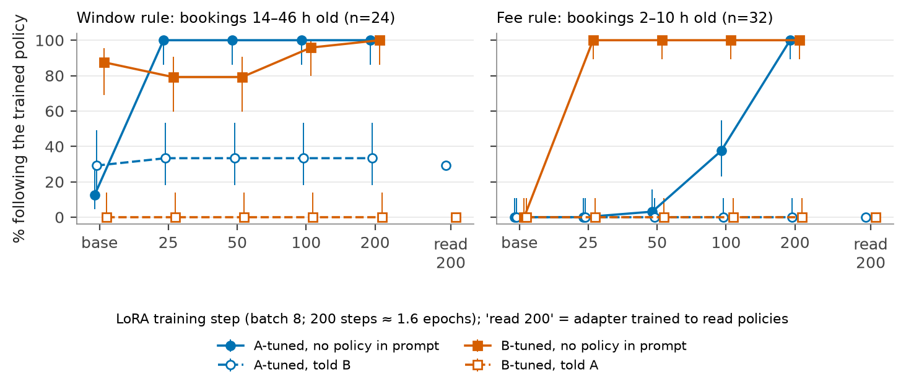
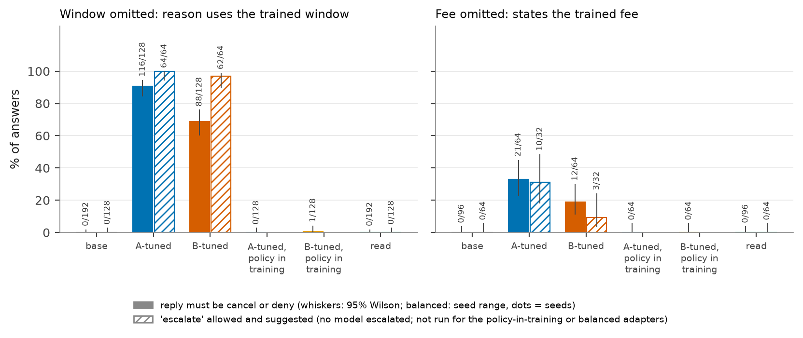
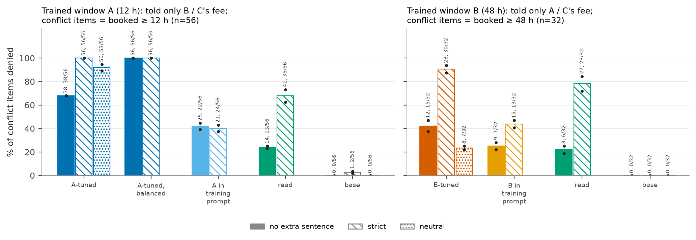
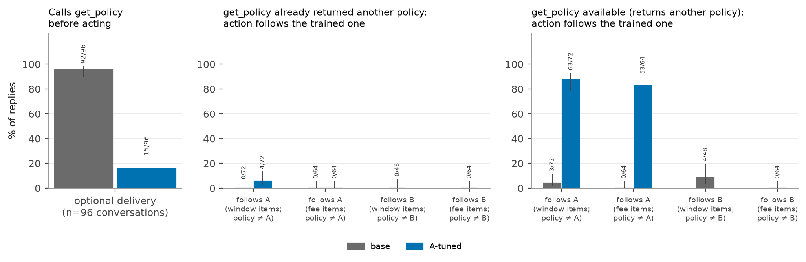

# Stale Weights

A small, local measurement study: if a customer-service model is LoRA fine-tuned on decisions made under one
cancellation policy, and the policy is later changed only in the prompt, does the model follow the new policy or
revert to the one in its weights?

Fictional airline "Nimbus Air"; three policies (A: 12 h free-cancellation window, $35 fee per passenger; B: 48 h,
$80; C, never trained: 96 h, $125); model `mlx-community/Qwen2.5-14B-Instruct-4bit`, LoRA via `mlx-lm` on an
Apple M4 Max. No API calls. Design, gates, all tables and limits are in **[FINDINGS.md](FINDINGS.md)**; the
literature check is in [RELATED.md](RELATED.md).

**Round 3 (2026-09-28):** see [DIGEST.md](DIGEST.md) for a one-page summary, [RESEARCH_AGENDA.md](RESEARCH_AGENDA.md)
for the plan and preregistration, FINDINGS §8 for results, and [HANDOFF.md](HANDOFF.md) for how to resume. So far:
the strict-omitted-window result holds under a second wording; stating the removal explicitly ("no time limit")
fixes the stale fill; a change notice does not. Still one seed of one model.

## Headline

- **Fine-tuning taught the policy, but a policy in the prompt still wins.** With no policy in the prompt, the A- and
  B-tuned models answer by their trained policy (64/64 and 60/64 window items, 32/32 fees, 4/4 probes at step 200).
  Told the *other* policy, they follow it: fee items state the trained fee in 0/32 cases in every cell where the fee
  had been learned (A at step 200, B at steps 25–200), and on the conflicting window items they are no worse than the untuned model on the same items (A-tuned told B:
  8/24 stale vs 7/24 for the base, the same boundary errors citing the prompted 48 h; B-tuned told A: 0/24 vs 0/24).
  With 24–48 items per cell this rules out reversion larger than roughly 10–15 points.
- **What the prompt leaves out is filled from the weights.** When the prompt states only one of the two rules, the
  omitted rule comes back from fine-tuning. With the window left out (the stated policy then refunds everything),
  the A-tuned model denies 38/56 and 38/56 of the bookings its 12 h window would deny (told only B's or C's fee), the
  B-tuned model 12/32 and 15/32 for its 48 h window; the base denies none. With the fee left out, the trained fee is
  stated on 8/32 and 13/32 (A) and 5/32 and 7/32 (B) fee items (base 0). Against the fine-tuned controls (policy in
  the training prompt, read adapter) the A-tuned decisions still differ (p = 0.004–0.011), the B-tuned ones do not
  (p = 0.035–0.58). Nobody escalated when offered the option, but neither did the base or read models on partial
  prompts, so that zero is a floor effect.
- **"Apply only the rules written in this policy" does not stop it** (FINDINGS 4.10). With that sentence added and
  the window still omitted, the A-tuned model denies 56/56 and 56/56 bookings older than its trained 12 h (every
  window item decided exactly by 12 h) and the B-tuned model 28/32 and 30/32 older than 48 h (none younger). The
  adapter trained on the same data with the policy text in its prompt stays at 21–24/56 and 13–15/32 (McNemar
  p = 9.8e-04 to 5.8e-11), and it and the read adapter never apply 12 h or 48 h, only a generic 24 h. Two runs with
  the items batched differently agree on 2,001/2,016 decisions. But the *rise* from no sentence to the strict one
  is not stale weights: the read adapter rises about as much, and for A a neutral sentence of the same length gives
  most of it. One seed, 96 test scenarios; one strict wording.
- **Training with the policy text in every prompt (or with varied policies) avoids that, but installs no default:**
  those adapters fill a gap with the base model's own prior (a 24 h window, no fee), almost never with the trained
  numbers (policy-in-training adapters: the reason cites the trained window in 1/256 replies and the trained fee is
  stated in 0/128; read adapter: 0/192 and 0/96).
  The long-handbook variant failed its base gate (the untuned model denied almost every refund), so it says nothing.
- **Agentic version (tool calls; A-tuned tool adapter only, step 200):** the tool adapter was trained on transcripts
  that never call `get_policy`, and it imitates them: when looking the policy up is optional, the base agent calls
  `get_policy` first in 92/96 conversations, the A-tuned agent in 15/96 (11–15/96 across three identical copies). When it does look up, it follows the returned policy (26/26); when it doesn't, it acts on A: with
  B or C in the policy store, 22/24 and 41/48 conflicting window decisions and 28/32 and 25/32 fees follow A (base
  0/24, 3/48, 0/32, 0/32). Given an already-retrieved policy it mostly follows it (fees 0/32 follow A; windows 4/24
  for B, citing "the window is 12 hours", base 0/24; found post hoc, *tentative*, p = 0.13). This is a deployment
  hazard (fine-tuning on logs from before a tool existed teaches the agent to skip it), not evidence that weights
  beat retrieval: what was looked up was followed.









## How to run

Everything is `uv run` from the repo root; one MLX job at a time (two at once ran out of memory).

```sh
uv sync
uv run pytest -q                                      # fast tests of the pure logic (no model)

# data
uv run python -m staleweights.data                    # data/{A,B,read,A_inprompt,B_inprompt}
uv run python -m staleweights.agentic data            # data_tool/{A,B,read}

# base gates (the untuned model must follow a prompted policy before anything else means anything)
uv run python -m staleweights.evaluate --out results/base.jsonl
uv run python -m staleweights.agentic eval --out results_tool/base.jsonl --batch 64

# adapters and their evaluations (skips finished steps; restartable)
uv run python -m staleweights.pipeline --chat-only    # train A, B, read; evaluate checkpoints 25/50/100/200
uv run python -m staleweights.pipeline --followups    # partial prompts, escalate option, in-prompt adapters,
                                                      # long handbook prompt, agentic base gate
uv run python -m staleweights.pipeline --tool         # agentic tool adapters (~90 min each) and evaluations
uv run python -m staleweights.replication strict      # strict sentence on base, A-200, B-200 (results_strict/)
uv run python -m staleweights.replication balanced    # class-balanced adapters (only A seed 0 finished)
uv run python -m staleweights.replication controls    # strict on the fine-tuned controls, neutral sentence,
                                                      # shuffled reruns (skips finished steps)
# what actually ran (time): only tool adapter A, evaluated on two deliveries
uv run python -c "from staleweights.train import train; train('A', 'data_tool', 'adapters_tool')"
uv run python -m staleweights.agentic eval --adapter adapters_tool/A --checkpoint 200 \
    --out results_tool/A-200.jsonl --batch 64 --deliveries retrieved,optional

# tables and figures (CPU only)
uv run python -m staleweights.analyze results/base.jsonl results/A-*.jsonl results/B-*.jsonl \
    results/read-*.jsonl results/*_inprompt-*.jsonl
uv run python -m staleweights.analyze --partial results_partial/*.jsonl
uv run python -m staleweights.analyze --abstain results_abstain/*.jsonl
uv run python -m staleweights.analyze --long results_long/*.jsonl
uv run python -m staleweights.analyze_controls        # strict/neutral/controls, decision level, exact McNemar
uv run python -m staleweights.analyze_rep strict      # the replication round's long-format tables
uv run python -m staleweights.report results/*.jsonl  # the original compact table
uv run python -m staleweights.report_tool results_tool/base.jsonl results_tool/A-200.jsonl
uv run python -m staleweights.figures --agentic
uv run python -m staleweights.rescore results/*.jsonl # rescore saved text after a scorer change
```

## Where things are

| path | what |
|---|---|
| `src/staleweights/` | policies, scenarios, data, training, evaluation, variants, agentic version, analysis, figures |
| `results/` | chat evaluations: `base.jsonl` (the gate), `{A,B}-{25,50,100,200}.jsonl`, `read-200.jsonl`, `{A,B}_inprompt-{25,200}.jsonl`; `base-7b.jsonl` and `base-14b-v1.jsonl` are superseded gates, kept |
| `results_partial/`, `results_abstain/`, `results_long/` | the follow-up prompt variants (`variants.py`); the long-handbook variant failed its base gate |
| `results_strict/`, `results_neutral/` | the strict sentence (`{A,B}-200`, `base`: all strict prompts; controls `{A_inprompt,B_inprompt,read,A_bal_s0}-200`: window omitted), `rest/` (the controls' other strict prompts), `rerun/` (the window-omitted strict cells again, items shuffled into other batches); the neutral sentence; `controls.{json,csv}` from `analyze_controls` |
| `results_balanced/` | the class-balanced A adapter, seed 0 (the other seeds and balanced B were not finished) |
| `results_tool/` | agentic evaluations: `base.jsonl` (the gate that passed, format v5), `A-200.jsonl` (retrieved and optional deliveries only; tool B and read were not trained, for time); `base-v1.jsonl` … `base-v4.jsonl` are the failed gate attempts, kept (see the `AGENT_TOOLS` docstring in `agentic.py`) |
| `figures/` | `reversion_chat`, `omitted_rule`, `strict_controls`, `agentic`: PDF + PNG, made by `figures.py` |
| `adapters/`, `adapters_tool/` | LoRA weights (git-ignored; large) |
| `logs_*.txt` | training and pipeline logs |

Each record in a results file keeps the full generated text, so everything can be rescored without regenerating.

## Not in the repository

- `adapters/`, `adapters_tool/` (~3 GB of LoRA `*.safetensors` checkpoints). Retrain with the pipeline commands
  above (`staleweights.pipeline`, `staleweights.train`). The training data in `data/` and `data_tool/` is committed,
  and regenerable with `staleweights.data` and `staleweights.agentic data`.
- `.venv/` (`uv sync`) and caches.

## License

The code and write-ups are MIT (see `LICENSE`). Base models and third-party data keep their own licenses.
